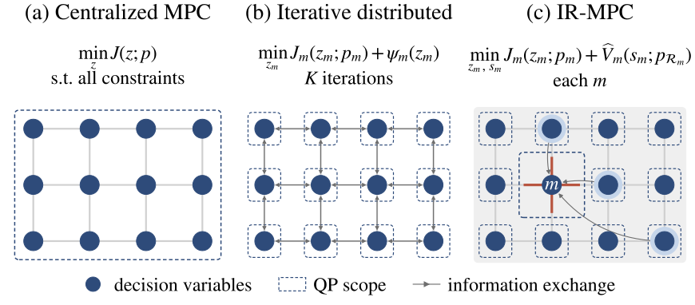
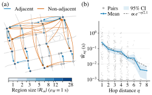

# Information-Region MPC

**Non-iterative distributed control of urban traffic signals**

[](LICENSE)
[](https://creativecommons.org/licenses/by/4.0/)
[](https://www.python.org/)
[](https://eclipse.dev/sumo/)

Code and data of the paper

> Q. Hu, M. Yang, M. Wang, and C. Tan, "Information-Region MPC: Non-Iterative Distributed Control of Urban Traffic Signals," submitted to the 2027 European Control Conference (ECC).

<p align="center">
  <picture>
    <source media="(prefers-color-scheme: dark)" srcset="figures/out/paradigms-dark.svg">
    
  </picture>
</p>

## Idea

Centralized MPC finds the best green times for the whole network, but its computation time grows quickly with the network size. Iterative distributed MPC makes the local problems small, but the controllers must exchange information many times within each signal update.

Information-region MPC (IR-MPC) approximates the first control input of centralized MPC **without iterations**:

- **Offline**, historical centralized solutions give, for every intersection, a quadratic approximation of the optimal cost of the rest of the network (the boundary value function), and couplings that show how much each other intersection changes the centralized green times of this intersection. The couplings select a small **information region** for each intersection.
- **Online**, each intersection reads current data only from its information region, updates the approximation, and solves **one local QP**.

## Main results

| Real 28-intersection network (SUMO, 10 test days) | Value |
|---|---|
| Control inputs identical to centralized MPC (1-s resolution) | 85% |
| Control inputs within 2 s of centralized MPC | 99.3% |
| Change of mean delay against centralized MPC | +0.03% |
| Change of closed-loop cost against centralized MPC | +0.02 ± 0.11% |
| Speed-up against centralized MPC / against OSD with 4 iterations | 9× / 15× |

On synthetic grids of 49 to 500 intersections, the local computation time of IR-MPC stays nearly constant (0.016–0.024 s), the mean information region contains about two intersections, and 98–100% of the test control inputs are within 2 s of centralized MPC.

<p align="center">
  <picture>
    <source media="(prefers-color-scheme: dark)" srcset="figures/out/coupling_row-dark.svg">
    
  </picture>
  <br><em>Couplings on the real network: (a) strongly coupled pairs in the high-demand period, (b) coupling against hop distance.</em>
</p>

## Repository layout

```
realnet/                 real 28-intersection network in SUMO (Sec. V-A to V-D, Tables I and II, Fig. 3)
  code/                  controllers, offline design, closed-loop runs, tables
  v3/                    QP model, solver wrapper and inputs shared with an earlier study
  demand/                the 30 demand days (20 history, 10 test)
  design/, inputs/       calibrated design inputs, signal plans, couplings and regions
  results_*/             run summaries and table files
  generator/             Lianyungang network and demand generator
grid/                    synthetic grids of 49-500 intersections (Sec. V-E, Table III)
  archive/               archived networks, traffic states and trial results behind Table III
figures/                 scripts for Figs. 1-3; out/ holds the generated figures
EXPERIMENT_NOTES.md      details that the paper does not report (see below)
CITATION.cff             citation metadata
```

## Requirements

- Windows; the run scripts use Git Bash.
- Python 3.13 with numpy 2.4.4, scipy 1.17.1, clarabel 0.11.1, osqp 1.1.1, networkx 3.6.1, matplotlib 3.10.9 and Pillow 12.2.0.
- Eclipse SUMO 1.26.0 for the closed-loop runs. Put `$SUMO_HOME/tools` on `PYTHONPATH`. If `sumo.exe` is not in `C:/Program Files (x86)/Eclipse/Sumo/bin/`, set `SUMO_BIN` to its path.
- Set `PY` to the Python interpreter before you run a shell script. The scripts set the BLAS thread variables to 1.

## Quick start: regenerate the figures

The figures need only the included data and run in about a minute:

```bash
cd figures
python fig_paradigms.py out        # Fig. 1
python fig_scenario_s77.py         # Fig. 2
python fig_coupling_s77_row.py     # Fig. 3 (also writes out/coupling_map_stats.json)
```

The PNG files in `figures/out/` are byte-identical to the figures in the paper (`paradigms.png` is `paradigms_crop.png` of the paper). `python readme_svgs.py` writes the light and dark SVG versions of Figs. 1 and 3 that this README shows.

## Full reproduction: real network

All constants are in `realnet/code/cc_design.py`: step T = 60 s, horizon N = 8, cycles of 60 or 120 s, green times of 10–60 s, the KKT tolerances, the history days (seeds 1–20) and the test days (seeds 101–104, 106–111). Run every step from `realnet/code`.

> **Before you rerun:** the included run folders hold only `SUMMARY.json` and `COMPLETE.json`. The run scripts skip every folder that has a `COMPLETE.json`, and the later steps need the complete run folders. Move `results_v1/runs`, `results_ir_v1/runs` and `results_osd_v1/runs` to another place first.

<details>
<summary><b>Step 1. Demand days</b> (already included in <code>realnet/demand/</code>)</summary>

```bash
python ../generator/tools/prepare_lyg_d100_dynamic.py --seed 1 --seed 2   # and so on, for all 30 seeds
python resolve_routes.py <generator route file> ../demand/day<seed>.rou.xml
```

`resolve_routes.py` writes every route inline.
</details>

<details>
<summary><b>Step 2. Design inputs from the history days</b> (already included)</summary>

| Order | Script | Output |
|---|---|---|
| 1 | `calibrate.py` | turning rates, arrival table, service groups (`design/`, `inputs/network_model.json`) |
| 2 | `fix_saturation.py` | 0.5 veh/s on signalized lanes without measured rates |
| 3 | `choose_cycles.py` | cycle of 60 or 120 s by Webster delay (`design/CYCLE_CHOICE.json`) |
| 4 | `make_signals.py` | signal plans (`inputs/mix_signals.json`) |

`realnet/v3/` holds the read-only inputs and the QP and solver modules of an earlier study; `frozen.py` adds `realnet/v3/code` to the Python path.
</details>

<details>
<summary><b>Step 3. Closed-loop runs in SUMO</b></summary>

`cc_scenario.py --seed <day> --out <folder> --max-time 14400 --controller {central|ir|osd}` runs one day.

| Script | Content |
|---|---|
| `run_central.sh` | centralized MPC on the 20 history days and the 10 test days |
| `run_rest.sh` | IR-MPC offline design (step 4), IR-MPC on the test days, and the tables (step 5) |
| `run_continue.sh`, `run_bankfix.sh`, `run_sparsefm.sh` | the same IR-MPC steps, run again after code fixes; the last run gives the paper results |
| `run_osd.sh`, `run_osd_after.sh` | OSD-1, OSD-2 and P-OSD with K = 1 and 4 on the test days, then the tables |
</details>

<details>
<summary><b>Step 4. IR-MPC offline design</b></summary>

| Command | Output |
|---|---|
| `ir_offline.py coupling` | couplings and information regions at ε_W = 1 s (`design/ir/W_SAMPLES.json`, `design/ir/REGIONS.json`, both included) |
| `ir_offline.py bank` | boundary functions for every update time (`design/ir/bank/`, about 600 MB, not included) |
</details>

<details>
<summary><b>Step 5. Tables and numbers of the paper</b></summary>

| Command | Paper content |
|---|---|
| `ir_tables.py samples` | Table I: errors on the 50 test samples |
| `ir_partition.py accuracy` | Table I: P-OSD errors |
| `ir_partition_timing_onepass.py` | Table I: computation times, all 50 samples in one run |
| `ir_tables.py closed` | Sec. V-D: closed-loop agreement with centralized MPC (85%, 99.3%) |
| `closed_loop_cost.py` | Table II: closed-loop cost difference ΔJ_cl (`results_review/closed_loop_cost.md`, included) |
| `fill_tables.py` | Table II (delay, TTS) and the numbers in the text (`results_ir_v1/PAPER_TABLES.json`) |

`fill_tables.py` uses `table_template.tex` for the layout and needs the complete run folders. In `PAPER_TABLES.json`, the key `table1` holds the closed-loop results (Table II of the paper) and `table3` the 50-sample results (Table I).
</details>

**Definitions in Tables I and II.** The error is the maximum absolute next-cycle green-time difference over the phases, relative to centralized MPC; it covers all next-cycle decisions of the samples, including failed local problems (IR-MPC keeps the previous green times, OSD keeps its previous iterate). The computation time is the median over the 50 test samples of the time of the slowest simultaneously solved local QP or subnetwork, summed over the iterations for OSD; it assumes one processor per local problem and excludes communication time. The ± values in Table II are 95% confidence intervals over the ten test days.

## Full reproduction: synthetic grids

See [`grid/README.md`](grid/README.md). A 1-s flow model replaces SUMO. `grid/run_all.sh` runs all steps, and `grid/make_tables.py` writes the numbers of Table III.

**Archived data.** [`grid/archive/`](grid/archive/) holds, for N = 49, 100, 200 and 500, the networks, the traffic states of the six centralized days, the trial results `IR_TRIAL_N{N}.json` and the tables behind Table III (`grid/archive/results/`). [`grid/archive/VERSION.md`](grid/archive/VERSION.md) records the code, the machine and the software of every run. The twelve state files of N = 200 and 500 are larger than 100 MB and are assets of the release [`grid-states-v1`](https://github.com/Tarard/Information-Region-MPC/releases/tag/grid-states-v1); download them with

```bash
python grid/archive/get_large_states.py
```

Then `NS_ROOT=grid/archive python grid/ir_trial.py N` solves the current QP at the archived states, as for Table III.

## Experiment notes

[`EXPERIMENT_NOTES.md`](EXPERIMENT_NOTES.md) records what the 8-page paper does not report: SUMO collisions and teleports per run, the excluded days, the timing procedure and machines, the exact definitions behind Tables I–III, the 50-sample selection, the rounding to whole seconds, the candidate region sizes, the scope of the grid experiment, and a correction of the Fig. 3 script.

## Citation

If you use the code or the IR-MPC results, please cite:

```bibtex
@unpublished{hu2026irmpc,
  title  = {Information-Region {MPC}: Non-Iterative Distributed Control of Urban Traffic Signals},
  author = {Hu, Qiongdan and Yang, Menglin and Wang, Meng and Tan, Chaopeng},
  note   = {Submitted to the 2027 European Control Conference (ECC)},
  year   = {2026},
  url    = {https://github.com/Tarard/Information-Region-MPC}
}
```

The Lianyungang network and the demand generator come from earlier work of Tan et al. If you use them, please also cite:

- C. Tan, M. Rinaldi, Y. Zeng, M. Wang, K. Tang, and H. van Lint, "Private-MP: Privacy-preserving Max-Pressure control based on heterogeneous data fusion," *Transportation Research Part C: Emerging Technologies*, vol. 191, p. 105848, 2026.
- C. Tan, Q. Hu, and M. Wang, "Regret-based Max-Pressure traffic signal control under uncertain traffic states," arXiv:2610.32290, 2026.

## License

- Code: [MIT License](LICENSE).
- Data (the Lianyungang network, the demand days, the design inputs, the coupling samples and the result files): [CC BY 4.0](https://creativecommons.org/licenses/by/4.0/).

## Contact

Qiongdan Hu, Chair of Traffic Process Automation, Technische Universität Dresden — qiongdan.hu@tu-dresden.de
